# Cahier des Charges - Projet Crypto Arbitrage

## 1. Membres d'équipe
- **Steven T.**
- **Baptiste D.**

*(Note : Projet réalisé en binôme)*

## 2. Présentation du sujet
Le projet porte sur la réalisation d'une plateforme de **Crypto Funding Arbitrage**.
L'objectif est de surveiller et d'analyser les taux de financement (Funding Rates) sur différents échanges de crypto-monnaies (DEX).
L'application permet aux utilisateurs de repérer des opportunités d'arbitrage "delta-neutral" en identifiant les écarts de taux entre différentes plateformes pour un même actif.

## 3. Présentation des cas d'utilisation
Les fonctionnalités principales attendues sont :

### Pour l'utilisateur final :
- **Tableau de bord (Dashboard)** : Vue d'ensemble des opportunités d'arbitrage les plus rentables en temps réel.
- **Comparateur de taux** : Visualisation des taux de financement actuels par crypto-actif et par plateforme (Paradex, Hyperliquid, Lighter, etc.).
- **Graphiques historiques** : Consultation de l'évolution des taux et des spreads d'arbitrage sur différentes échelles de temps.
- **Détails par actif** : Page dédiée pour chaque crypto-monnaie affichant les données agrégées de tous les marchés disponibles.

### Pour le système (Backend) :
- **Collecte de données** : Récupération automatisée et périodique des taux via les APIs des échanges.
- **Normalisation** : Harmonisation des données provenant de sources hétérogènes.
- **Détection d'opportunités** : Calcul automatique des spreads (différence entre taux Long et Short max).
- **Historisation** : Stockage optimisé des données pour l'analyse temporelle (agrégations).

## 4. Schéma d'architecture
L'application repose sur une architecture **Microservices** conteneurisée :

- **Frontend** : Application hybride web/mobile développée avec **Nuxt.js (Vue 3)** suivant une architecture **MVVM** (Model-View-ViewModel) via les Composables Vue pour une séparation claire des responsabilités.
- **Backend** : Écosystème **Java Spring Boot** divisé en microservices :
    - **Auth Service** : Gestion de l'authentification et des utilisateurs.
    - **Funding Service** : Responsable de la récupération des données de marché (Scraping/REST) et de leur stockage.
    - **Arbitrage Service** : Moteur de calcul des opportunités et gestion des statistiques d'arbitrage.
- **Base de données** : **PostgreSQL** pour le stockage persistant relationnel.
- **Infrastructure** : Déploiement orchestré par **Docker Compose**.

## 5. Résultat attendu côté mobile
L'application est conçue avec une approche **Responsive Design** pour garantir une expérience fluide sur mobile :
- **Navigation adaptée** : Menu adapté aux écrans tactiles.
- **Tableaux réactifs** : Les grilles de données (DataGrids) sont adaptées pour être consultables sur petits écrans (scroll horizontal ou mode cartes).
- **Graphiques tactiles** : Les courbes de taux sont manipulables au toucher.
- **Performance** : Chargement rapide des données pour une utilisation en mobilité.

## 6. Modélisation de la base de données

Le schéma relationnel s'articule autour des entités clés identifiées dans le projet.

### Diagramme Entité-Relation (ERD)

```mermaid
erDiagram
    %% ========== UTILISATEURS ==========
    USERS {
        bigserial id PK
        varchar wallet_address UK "42 chars"
        varchar role "USER | ADMIN"
        varchar plan "FREE | PRO"
        timestamp plan_expires_at
        timestamp created_at
        timestamp last_login_at
        varchar nonce
    }

    %% ========== RÉFÉRENTIELS ==========
    TICKER {
        serial id PK
        varchar base_symbol "20 chars"
        varchar normalized_symbol UK "50 chars"
        varchar icon_url
        timestamp created_at
    }

    DEX {
        bigserial id PK
        varchar name UK "50 chars"
        varchar base_url
        varchar api_key
        int funding_interval_hours
        boolean active
        varchar color "20 chars"
        varchar trade_url_pattern "200 chars"
        varchar icon_url "500 chars"
        timestamp created_at
    }

    DEX_MARKET {
        bigserial id PK
        bigint dex_id FK
        int ticker_id FK
        varchar symbol "50 chars"
        varchar original_symbol
        boolean active
        timestamp updated_at
    }

    %% ========== DONNÉES TEMPS RÉEL ==========
    FUNDING_RATE {
        bigserial id PK
        bigint dex_id FK
        int ticker_id FK
        decimal rate "20,12"
        decimal rate_8h "20,12"
        decimal rate_annual "20,4"
        decimal funding_premium "20,8"
        decimal funding_index "30,12"
        int interval_hours
        timestamp timestamp
        timestamp created_at
    }

    LAST_FUNDING {
        bigserial id PK
        int ticker_id FK
        bigint dex_id FK
        decimal rate "20,12"
        decimal rate_8h "20,12"
        decimal rate_annual "20,4"
        decimal funding_premium "20,8"
        decimal funding_index "30,12"
        int interval_hours
        timestamp timestamp
        timestamp updated_at
    }

    %% ========== AGRÉGATIONS TEMPORELLES ==========
    FUNDING_RATE_5MIN {
        bigserial id PK
        int ticker_id FK
        bigint dex_id FK
        timestamp bucket_time
        decimal avg_rate "20,12"
        decimal min_rate "20,12"
        decimal max_rate "20,12"
        decimal avg_rate_8h "20,12"
        decimal avg_rate_annual "20,4"
        decimal open_rate "20,12"
        decimal close_rate "20,12"
        int sample_count
        timestamp created_at
    }

    FUNDING_RATE_HOURLY {
        bigserial id PK
        int ticker_id FK
        bigint dex_id FK
        timestamp bucket_time
        decimal avg_rate "20,12"
        decimal min_rate "20,12"
        decimal max_rate "20,12"
        decimal avg_rate_8h "20,12"
        decimal avg_rate_annual "20,4"
        decimal open_rate "20,12"
        decimal close_rate "20,12"
        int sample_count
        timestamp created_at
    }

    FUNDING_RATE_DAILY {
        bigserial id PK
        int ticker_id FK
        bigint dex_id FK
        date date
        decimal avg_rate "20,12"
        decimal min_rate "20,12"
        decimal max_rate "20,12"
        decimal avg_rate_8h "20,12"
        decimal avg_rate_annual "20,4"
        int sample_count
        timestamp created_at
    }

    %% ========== ARBITRAGE & POSITIONS ==========
    ARBITRAGE_OPPORTUNITY {
        bigserial id PK
        bigint dex1_id FK
        bigint dex2_id FK
        int ticker_id FK
        decimal dex1_rate "20,12"
        decimal dex2_rate "20,12"
        decimal spread "20,12"
        decimal projected_daily_return "20,8"
        varchar recommended_long_dex "50 chars"
        varchar recommended_short_dex "50 chars"
        timestamp detected_at
        varchar status "ACTIVE | ..."
    }

    POSITION {
        bigserial id PK
        bigint dex_id FK
        int ticker_id FK
        varchar side "LONG | SHORT"
        decimal size "18,8"
        decimal entry_price "18,8"
        timestamp opened_at
        timestamp closed_at
        decimal pnl "18,8"
        varchar status "OPEN | CLOSED"
    }

    %% ========== RELATIONS ==========
    DEX ||--o{ DEX_MARKET : "has markets"
    DEX ||--o{ FUNDING_RATE : "publishes"
    DEX ||--o{ LAST_FUNDING : "current rate"
    DEX ||--o{ FUNDING_RATE_5MIN : "aggregates"
    DEX ||--o{ FUNDING_RATE_HOURLY : "aggregates"
    DEX ||--o{ FUNDING_RATE_DAILY : "aggregates"
    DEX ||--o{ POSITION : "trades on"
    DEX ||--o{ ARBITRAGE_OPPORTUNITY : "dex1"
    DEX ||--o{ ARBITRAGE_OPPORTUNITY : "dex2"

    TICKER ||--o{ DEX_MARKET : "traded as"
    TICKER ||--o{ FUNDING_RATE : "has rates"
    TICKER ||--o{ LAST_FUNDING : "latest"
    TICKER ||--o{ FUNDING_RATE_5MIN : "aggregated"
    TICKER ||--o{ FUNDING_RATE_HOURLY : "aggregated"
    TICKER ||--o{ FUNDING_RATE_DAILY : "aggregated"
    TICKER ||--o{ ARBITRAGE_OPPORTUNITY : "opportunity for"
    TICKER ||--o{ POSITION : "position on"
```

### Description des tables

| Table | Description | Rétention |
|-------|-------------|-----------|
| `users` | Authentification par wallet Ethereum (MetaMask) | Permanent |
| `ticker` | Référentiel des crypto-actifs normalisés (BTC, ETH...) | Permanent |
| `dex` | Configuration des exchanges décentralisés | Permanent |
| `dex_market` | Mapping des symboles par DEX | Permanent |
| `funding_rate` | Données brutes des taux de financement | ~24h |
| `last_funding` | Dernier taux par ticker/DEX (cache) | Temps réel |
| `funding_rate_5min` | Agrégation 5 minutes pour charts intraday | 24h |
| `funding_rate_hourly` | Agrégation horaire pour charts 1D-7D | 7 jours |
| `funding_rate_daily` | Agrégation journalière pour historique | Permanent |
| `arbitrage_opportunity` | Opportunités d'arbitrage détectées | Variable |
| `position` | Positions de trading ouvertes/fermées | Permanent |
